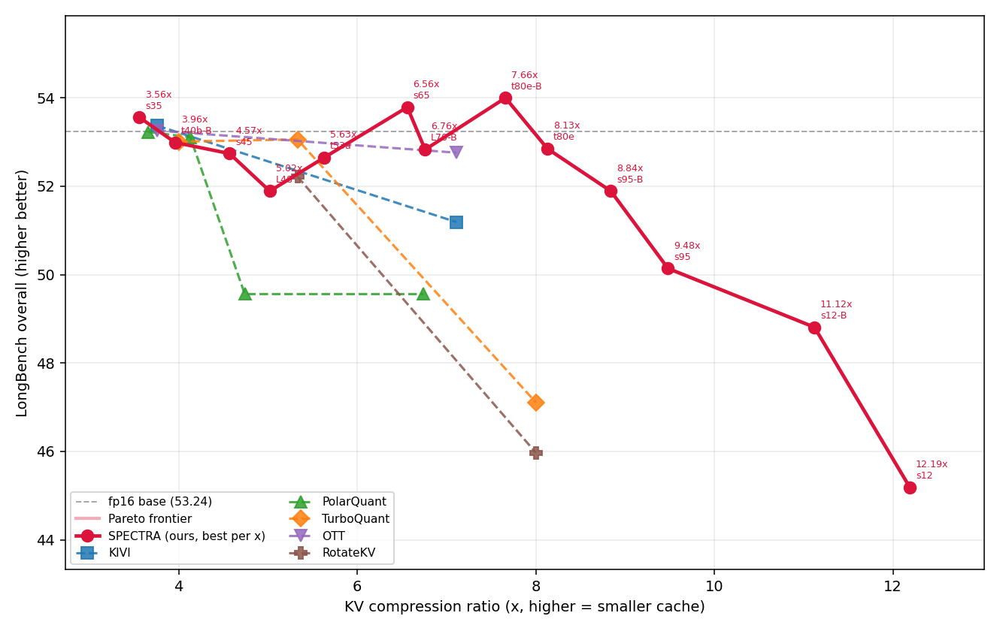
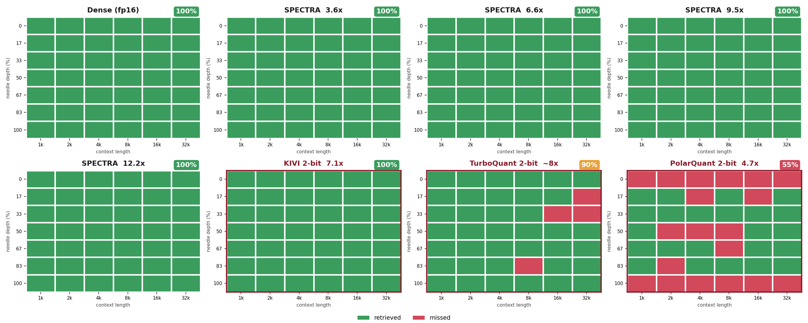
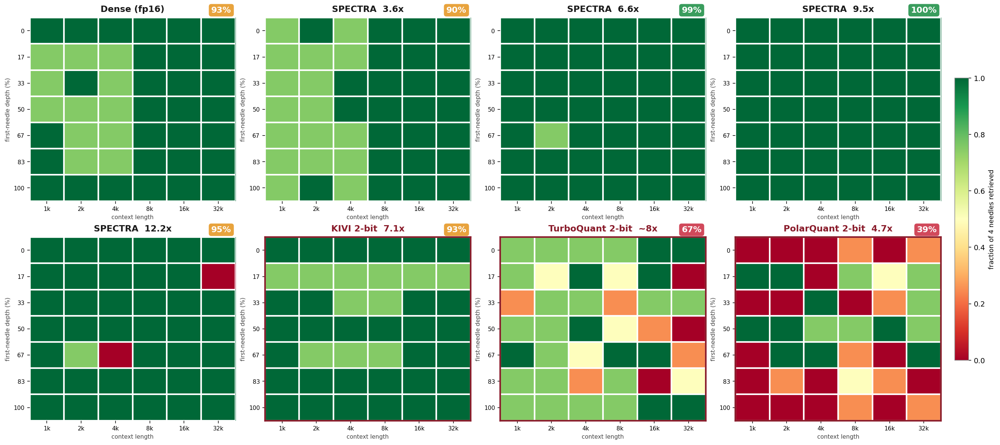

<div align="center">

# SPECTRA: Transform Coding for the KV Cache

**Cache the latent, not the keys and values.**

[](https://arxiv.org/abs/2608.07915)
[](LICENSE)
[](https://www.python.org)



</div>

## Overview

SPECTRA is a **one-shot, training-free** compressor for the LLM KV cache. Instead of asking *how cheaply
to store* `K` *and* `V`, it changes *what* is stored: a data-optimal, decorrelated, **energy-ordered
latent** obtained by an activation-aware (`G`-weighted) transform and quantized by **reverse water-filling**
bit allocation — **JPEG for the KV cache** (a Karhunen–Loève transform followed by rate–distortion bit
allocation on its coefficients). It folds into `k_proj`/`v_proj` (plus a closed-form `o_proj` correction),
so standard `model.generate()` just works — no fine-tuning.

> Paper: [*SPECTRA: Pushing the KV Cache Beyond the 2-Bit Cliff via Spectral Transform Coding*](https://arxiv.org/abs/2608.07915) — arXiv:2608.07915.

## Highlights

- 🎛️ **Transform coding for KV** — a `G`-weighted, KLT-like transform + reverse water-filling bit allocation.
- 🪶 **Training-free & one-shot** — post-hoc; absorbed into the weights, so `generate()` works unchanged.
- 📉 **Past the 2-bit cliff** — a *rank* knob added to the *bit* knob keeps quality where scalar/rotation quantizers collapse.
- 🔌 **vLLM plugin** — store the int4 latent directly in vLLM's paged KV cache for real KV-memory savings.

## Install

```bash
pip install -e .     # or: pip install -r requirements.txt   (or: conda env create -f environment.yml)
```

Python ≥3.10. Tested stack: PyTorch 2.x, Transformers 5.11, `datasets` 3.6 (pinned `<4` — v4 dropped the
script loader LongBench needs). Models/datasets download to your Hugging Face cache; set `HF_HOME` if your
default disk is small.

## Quickstart

```python
import spectra

model, tok = spectra.compress("Qwen/Qwen2.5-7B-Instruct", ratio="5x")   # 3x / 5x / 6x / 9x / 12x
out = model.generate(**tok("The KV cache is", return_tensors="pt").to(model.device), max_new_tokens=40)
print(tok.decode(out[0]))

spectra.save(model, "spectra_qwen_5x")        # tiny delta (factors only)
model, tok = spectra.load("spectra_qwen_5x")  # rebuild from HF base + delta
```

`3x`/`5x`/`6x` are water-filling (near-lossless); `9x`/`12x` are aggressive low-rank. Override any point
with `bits=` / `B=`.

## vLLM plugin

`spectra.vllm` stores the SPECTRA **int4 latent** directly in vLLM's paged KV cache (Mode A: gather the
latent by block table, dequantize, reconstruct `K,V` with exact RoPE, attend), so vLLM allocates more KV
blocks at fixed GPU memory — real KV-cache savings in a real serving engine.

```python
import spectra, spectra.vllm
m, tok = spectra.compress("NousResearch/Meta-Llama-3.1-8B-Instruct", ratio="vllm-7x")
spectra.save(m, "delta_vllm7x")
llm = spectra.vllm.LLM("NousResearch/Meta-Llama-3.1-8B-Instruct", "delta_vllm7x",
                       gpu_memory_utilization=0.85, max_model_len=32768)
```

Or `python demo/vllm_demo.py build ...` then `... serve ...`. Decode uses a training-free
reconstruct-then-attend path (exact quality); a fused Triton decode kernel is future work.

## Reproduce

```bash
# LongBench (SPECTRA + optional baselines), one model
python scripts/run_longbench.py --model NousResearch/Meta-Llama-3.1-8B-Instruct --configs 1024:3

# Needle-in-a-Haystack (fastest, ~minutes) — compresses on the fly and plots the retrieval heatmap
python scripts/run_niah.py --model NousResearch/Meta-Llama-3.1-8B-Instruct \
    --contexts 2048,8192,16384 --depths 0,25,50,75,100 --configs 1024:3 --out niah.json --fig-prefix niah
```

Baselines (KIVI, TurboQuant, PolarQuant, QuaRot) are re-implemented in `spectra/baselines.py` and run
through the **same** harness and cache-accounting as SPECTRA. Full per-model, per-task tables are in the paper.

## Results

SPECTRA is on par with the strongest quantizer at low compression and stays usable past the 2-bit cliff,
where scalar/rotation quantizers collapse; single-needle retrieval stays near-lossless across the range.

<div align="center">


</div>

## Repo layout

```
spectra/        method (method.py, quant.py, core.py) · easy API (api.py) · vLLM int4-latent cache (vllm.py)
                · HF serving (hf_serve.py) · baselines (baselines.py) · long-context eval (eval/)
modeling_spectra.py   self-contained HF model with a real int4-latent KV cache (trust_remote_code)
scripts/        run_longbench.py · run_niah.py · run_eval.py  +  tools/ (tables & figures)
demo/           demo.sh (HF one-click)  +  vllm_demo.py (int4-latent serving)
assets/         headline figures
```

## Citation

```bibtex
@misc{zhang2026spectrapushingkvcache,
      title={SPECTRA: Pushing the KV Cache Beyond the 2-Bit Cliff via Spectral Transform Coding}, 
      author={Jiamu Zhang and Liang Wu and Kelly Wan and Hanjie Chen and Liangjie Hong},
      year={2026},
      eprint={2608.07915},
      archivePrefix={arXiv},
      primaryClass={cs.LG},
      url={https://arxiv.org/abs/2608.07915}, 
}
```

## License

Released under the [MIT](LICENSE) license.
