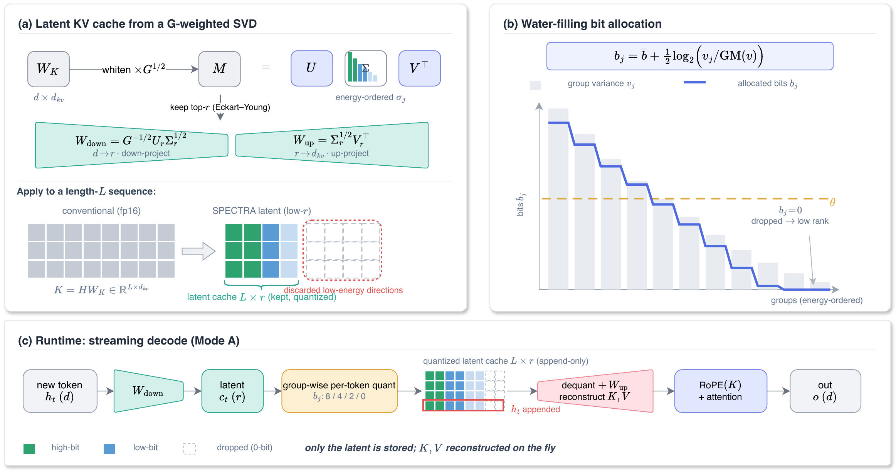

<div align="center">

# SPECTRA

**Cache the latent, not the keys and values.**

Training-free KV-cache compression by spectral transform coding, for 🤗 Transformers.

[](https://arxiv.org/abs/2608.07915)
[](#quick-start)
[](#installation)
[](LICENSE)

[Paper](https://arxiv.org/abs/2608.07915) · [Quick start](#quick-start) · [Results](#results) · [Reproduce](#reproduce) · [Docs](docs/) · [Citation](#citation)

</div>

---

Every layer of an LLM caches a key and a value vector for every token, and this KV cache often limits how long a
context or how many requests a GPU can hold. Most compressors keep the keys and values and store them with fewer
bits, and they break down below about 2 bits per value. **SPECTRA** changes what is cached. It maps each layer's keys
and values into a latent whose channels are ordered by energy, and gives the bits to the channels that carry the most
energy. Low-energy channels get zero bits, so the method moves from quantization to low rank smoothly. This is
transform coding, as in JPEG, applied to the KV cache. The transform folds into the model's projections, and nothing
is trained.

<p align="center">
  
</p>
<p align="center"><sub>(a) The latent comes from an SVD of the key and value projections, weighted by the
activations. (b) Reverse water-filling gives each channel group its bits; groups under the water level get zero bits.
(c) At decode only the quantized latent is stored, and keys and values are rebuilt from it.</sub></p>

## News

- **2026-11**: v0.2. The paper's operating points as presets, LongBench with the official prompts and scorer on the
  full test split, and compression ratios that count everything stored.
- **2026-08**: v0.1, open-source release.

## What is in this repo

| | What it stores | Use it for |
|---|---|---|
| [`spectra.compress`](#quick-start) (🤗 Transformers) | keys and values rebuilt from the quantized latent, in the stock cache | accuracy: the paper's numbers |
| [Packed INT4 cache](#memory-packed-int4-cache) (🤗 Transformers, vLLM 0.7) | the INT4 latent itself | memory: about 7× more tokens per GPU |

SPECTRA reduces memory, not decode time: the keys and values are rebuilt from the latent at every decoding step,
which is slower than dense attention.

## Installation

```bash
git clone https://github.com/nokia-applied-research/SPECTRA.git
cd SPECTRA
pip install -e .
pip install -e '.[eval]'          # LongBench metrics
```

Python ≥ 3.10, PyTorch ≥ 2.5, transformers ≥ 4.57, and `datasets` < 4 (LongBench needs its script loader). Tested on
H100 with torch 2.11, transformers 5.11 and datasets 3.6 ([`environment.yml`](environment.yml)).

---

## Quick start

```python
import spectra

model, tok = spectra.compress("NousResearch/Meta-Llama-3.1-8B-Instruct", preset="8.8x")

messages = [{"role": "user", "content": "Summarize the following report: ..."}]
inputs = tok.apply_chat_template(messages, add_generation_prompt=True,
                                 return_tensors="pt", return_dict=True).to(model.device)
out = model.generate(**inputs, max_new_tokens=256)
print(tok.decode(out[0, inputs["input_ids"].shape[1]:], skip_special_tokens=True))

spectra.save(model, "llama31_8.8x")        # small delta: the factors and the corrected o_proj
model, tok = spectra.load("llama31_8.8x")  # fetches the base model by id and applies the delta
```

`compress` reads 16 calibration windows of 2,048 tokens (WikiText-2 and Python code) and fits every layer in closed
form. Each preset is named by the KV compression it reaches on Llama-3.1-8B:

| Preset | KV compression | LongBench-8 |
|---|---|---|
| dense | 1× | 53.29 |
| `"3.6x"` | ~3.6× | 53.18 |
| `"4.6x"` | ~4.6× | 52.62 |
| `"6x"` | ~6× | 52.59 |
| `"7.7x"` | ~7.7× | 53.29 |
| `"8.8x"` | ~8.8× | 52.99 |
| `"11x"` | ~11× | 52.44 |

Mistral-7B compresses about the same. Qwen2.5-7B has a narrower KV cache and compresses less with the same preset. All
presets, what they set, and the Qwen2.5 settings are in [docs/presets.md](docs/presets.md).

---

## Results

LongBench, 8 English tasks, official prompts and scorer, full test split of every task. KV compression counts
everything a method stores, including scales and the few tokens kept exact.

**Llama-3.1-8B-Instruct**, LongBench-8 average:

| Method | KV compression | LongBench-8 |
|---|---|---|
| Dense (fp16) | 1× | 53.29 |
| KIVI | ~3.8× | 53.92 |
| **SPECTRA** | ~3.6× | 53.18 |
| OTT | ~7.1× | 53.30 |
| KIVI | ~7.1× | 52.17 |
| **SPECTRA** | ~7.7× | 53.29 |
| RotateKV | ~8× | 47.00 |
| TurboQuant | ~8× | 46.43 |
| **SPECTRA** | **~8.8×** | **52.99** |
| **SPECTRA** | **~11×** | **52.44** |

**Three models**, the strongest baseline at 7× or more against SPECTRA:

| Model | Dense | Best baseline at ≥ 7× | SPECTRA at ~8–9× | SPECTRA, highest ratio |
|---|---|---|---|---|
| Llama-3.1-8B-Instruct | 53.29 | 53.30 (OTT, ~7.1×) | 52.99 (~8.8×) | 52.44 (~11×) |
| Mistral-7B-Instruct-v0.3 | 52.78 | 52.51 (OTT, ~7.1×) | 52.32 (~8.9×) | 50.76 (~11×) |
| Qwen2.5-7B-Instruct | 53.23 | 47.18 (TurboQuant, ~8×) | 48.58 (~8×) | 47.67 (~8.8×) |

- **Up to about 7×**, SPECTRA is on par with the strongest quantizers, not ahead of them.
- **Past 8×**, only SPECTRA stays usable. No baseline goes beyond 8×, and at 8× the baselines lose 6–7 points on
  Llama.
- **Qwen2.5-7B** has 4 KV heads, so its cache is already narrow. SPECTRA reaches 8× there at about 4.7 points below
  dense.

**Needle in a haystack**, contexts 1K–32K × 7 depths, % of cells retrieved (one needle / four needles):

| | Llama-3.1-8B | Mistral-7B | Qwen2.5-7B |
|---|---|---|---|
| Dense (fp16) | 100 / 85.7 | 100 / 66.7 | 100 / 76.2 |
| **SPECTRA**, highest ratio tested | **100 / 100** | **100 / 70.8** | **100 / 76.2** |
| KIVI, ~7.1× | 100 / 93.5 | 92.9 / 52.4 | — |
| TurboQuant, ~8× | 88.1 / 63.1 | 66.7 / 47.0 | 100 / 66.7 |

SPECTRA here is ~11× on Llama and Mistral and ~5.6× on Qwen2.5. Every SPECTRA preset we tested finds the single
needle in every cell, on all three models.

Baselines run from their released code under the same protocol; their adapters are not part of this repo. Per-task
scores, every preset, the baseline settings and all NIAH rows are in [docs/results.md](docs/results.md).

---

## Reproduce

```bash
M=NousResearch/Meta-Llama-3.1-8B-Instruct

# LongBench-8, full test split (about 1 h per run on one GPU)
python scripts/run_longbench.py --model $M --out runs/dense.json                # 53.29
python scripts/run_longbench.py --model $M --preset 11x --out runs/11x.json     # 52.44, 11.09x

# needle in a haystack, one needle and four needles
python scripts/run_niah.py --model $M --preset 11x --out runs/niah.json                 # 100
python scripts/run_niah.py --model $M --preset 11x --needles 4 --out runs/niah4.json    # 100
```

Each LongBench output records the score and sample count per task, the context length of every sample, and the
compression over those samples.

---

## Memory: packed INT4 cache

`spectra.compress` measures accuracy, and the stock cache still holds keys and values. To store the latent itself, use
the preset `vllm-7x` (about 7× on Llama-3.1-8B):

```python
import spectra, spectra.vllm

m, tok = spectra.compress("NousResearch/Meta-Llama-3.1-8B-Instruct", preset="vllm-7x")
spectra.save(m, "llama31_vllm7x")

# vLLM 0.7.x: the INT4 latent lives in vLLM's paged KV cache
llm = spectra.vllm.LLM("NousResearch/Meta-Llama-3.1-8B-Instruct", "llama31_vllm7x",
                       gpu_memory_utilization=0.85, max_model_len=32768)
```

`python demo/vllm_demo.py build ...` then `... serve ...` prints the KV capacity against fp16. In 🤗 Transformers,
`spectra.hf_serve` stores the packed latent in place of the stock cache, and
[`modeling_spectra.py`](modeling_spectra.py) is a self-contained Llama with the same cache.

### Limits (v0.2)

- Decode is slower than dense on the packed paths: keys and values are rebuilt at every step, in PyTorch.
- The packed paths support the preset `vllm-7x` on Llama-family models. The other presets run through
  `spectra.compress` only.
- vLLM 0.7.x only, with `enforce_eager=True`.

---

## Tests

```bash
python tests/test_cpu.py     # accounting, quantizers, presets (CPU, no download)
bash demo/demo.sh            # compress + generate + WikiText-2 perplexity on one GPU
```

## TODO

- ✅ SPECTRA in 🤗 Transformers with the paper's presets
- ✅ The paper's LongBench-8 and needle-in-a-haystack protocols
- ✅ Packed INT4 latent cache in 🤗 Transformers and vLLM 0.7
- ⬜ A decode path faster than dense: attention on the latent without rebuilding the keys and values
- ⬜ Packed storage for all presets
- ⬜ Current vLLM releases
- ⬜ PyPI package

## Citation

```bibtex
@misc{zhang2026spectrapushingkvcache,
      title={SPECTRA: Pushing the KV Cache Beyond the 2-Bit Cliff via Spectral Transform Coding}, 
      author={Jiamu Zhang and Liang Wu and Kelly Wan and Hanjie Chen and Liangjie Hong},
      year={2026},
      eprint={2608.07915},
      archivePrefix={arXiv},
      primaryClass={cs.LG},
      url={https://arxiv.org/abs/2608.07915}, 
}
```

## License

SPECTRA is released under the [MIT](LICENSE) license. `spectra/eval/metrics.py` and `spectra/eval/config/` are copied
from [THUDM/LongBench](https://github.com/THUDM/LongBench) (MIT).

## Acknowledgements

SPECTRA builds on [🤗 Transformers](https://github.com/huggingface/transformers) and
[vLLM](https://github.com/vllm-project/vllm). Evaluation uses [LongBench](https://github.com/THUDM/LongBench);
calibration uses [WikiText-2](https://huggingface.co/datasets/Salesforce/wikitext) and
[codeparrot-clean-valid](https://huggingface.co/datasets/codeparrot/codeparrot-clean-valid).
